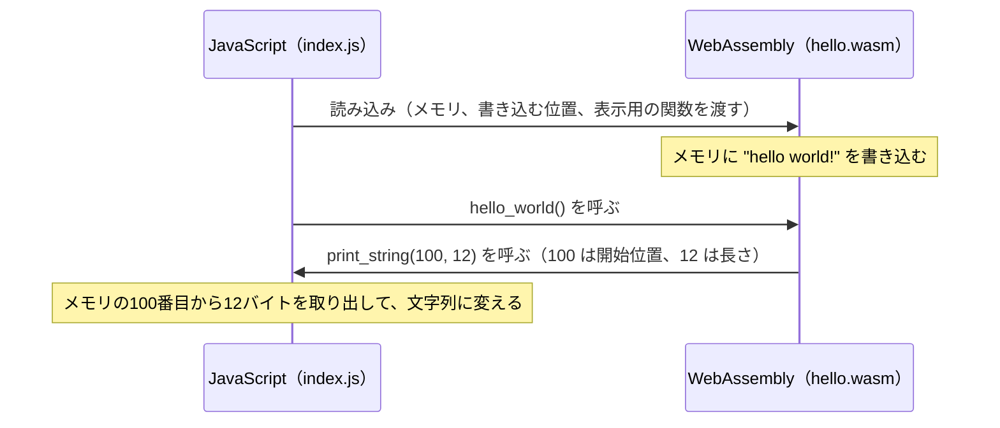

# Architecture（構成）

このリポジトリが、どういう部品でできていて、どこに何を書くのかの説明です。

- [1. 全体の流れ](#1-全体の流れ)
- [2. JavaScript と WebAssembly のやりとり](#2-javascript-と-webassembly-のやりとり)
- [3. プログラムの分け方](#3-プログラムの分け方)
- [4. ディレクトリ構成](#4-ディレクトリ構成)
- [5. テストの仕組み](#5-テストの仕組み)
- [6. 実行環境](#6-実行環境)
- [7. 注意点](#7-注意点)

---

## 1. 全体の流れ

WebAssembly は、テキスト形式（`.wat`）で書き、バイナリ（`.wasm`）に変換してから、JavaScript で読み込んで実行します。


| 段階 | 行うこと | 使うもの |
| --- | --- | --- |
| 書く | WebAssembly のモジュールを、テキスト形式で書きます | `.wat` ファイル |
| 変換 | テキスト形式を、バイナリに変換します。書き間違いは、ここで見つかります | [scripts/build.js](../scripts/build.js)（WABT というライブラリを使います） |
| 読み込み | バイナリを読み込んで、JavaScript から呼べる形にします | [src/shared/wasm.js](../src/shared/wasm.js)（Node.js の `WebAssembly` を使います） |
| 実行 | JavaScript から、WebAssembly の関数を呼びます | 各機能の `index.js` |

`.wasm` は、`.wat` から作れるので、Git の管理の対象から外しています。

---

## 2. JavaScript と WebAssembly のやりとり

WebAssembly は、数値しか扱えません。文字列を渡すには、「線形メモリ」という共有の領域に書き込んで、位置と長さを数値で伝えます。

`hello` の機能では、次の順にやりとりします。



やりとりの方向は、2つあります。

| 方向 | `.wat` での書き方 | JavaScript での書き方 |
| --- | --- | --- |
| JavaScript から WebAssembly へ渡す | `(import "env" "print_string" ...)` | 読み込むときに、`{ env: { print_string: ... } }` を渡す |
| WebAssembly から JavaScript へ公開する | `(func (export "hello_world") ...)` | `instance.exports.hello_world()` で呼ぶ |

`.wat` の `import` の名前と、JavaScript が渡すオブジェクトのキーは、一致している必要があります。合っていないと、読み込みの時点でエラーになります。

メモリの位置と長さは、WebAssembly の側から JavaScript に渡します。JavaScript の側で「どこを読むか」を別に覚えておく書き方にすると、片方だけを変えたときに、黙って別の場所を読んでしまいます。

---

## 3. プログラムの分け方

機能ごとに、ディレクトリを分けます。1つの機能は、次の3つのファイルでできています。

| ファイル | 役割 |
| --- | --- |
| `<機能名>.wat` | WebAssembly のモジュール |
| `index.js` | モジュールを読み込み、JavaScript から使いやすい関数にして公開します。メモリや、WebAssembly に渡す関数の用意も、ここで行います |
| `index.test.js` | テスト |

```
src/
├── main.js              ← 入口。各機能を呼び出す
├── shared/
│   └── wasm.js          ← どの機能でも使う処理（読み込み、メモリからの文字列の取り出し）
├── hello/
│   ├── hello.wat
│   ├── index.js
│   └── index.test.js
└── add/                 ← 足す機能
    ├── add.wat
    ├── index.js
    └── index.test.js
```

`index.js` は、WebAssembly の細かい事情（メモリの位置、アンダースコアの付いた名前）を、外に見せないようにします。使う側は、ふつうの JavaScript の関数として呼べます。

```javascript
const { helloWorld } = await createHello((text) => console.log(text));

helloWorld();
```

`main` ブランチには、`hello/` だけが入っています。引数と戻り値のある関数の例は、`example/add` ブランチにあります。

---

## 4. ディレクトリ構成

| ディレクトリ・ファイル | 内容 |
| --- | --- |
| `src/main.js` | 入口です。`make run` で実行されます |
| `src/shared/wasm.js` | どの機能でも使う処理 |
| `src/<機能名>/` | 機能ごとのプログラム |
| `scripts/build.js` | `.wat` を `.wasm` に変換するスクリプト |
| `package.json` | パッケージと、実行するコマンド（`scripts`）の定義 |
| `pnpm-lock.yaml` | 実際にインストールされるパッケージの、正確なバージョンの記録 |
| `eslint.config.js` | ESLint（規則の検査）の設定 |
| `.prettierrc.json`、`.prettierignore` | Prettier（書式の検査と整形）の設定 |
| `.node-version` | Node.js のバージョン。コンテナを使わずに、手元の Node.js で動かすときに参照されます |
| `Dockerfile`、`docker-compose.yml` | コンテナの定義 |
| `Makefile` | よく使うコマンドをまとめたもの |
| `.github/workflows/test.yml` | 自動テストの設定 |
| `.github/dependabot.yml` | Dependabot（依存の更新の通知）の設定 |
| `readme/` | このリポジトリの文書 |

---

## 5. テストの仕組み

テストは、機能のディレクトリの中に、`index.test.js` という名前で置きます。Node.js に標準で付いているテストの機能（`node:test`）を使うので、テスト用のパッケージは入れていません。

- **`.wasm` を実際に読み込んで、確かめます。** WebAssembly の動きを、作り物に置き換えません。そのため、テストの前に、変換が必要です（`make js/test` は、変換を先に行います）。
- **`index.js` が公開している関数を呼びます。** WebAssembly を直接さわらず、使う側と同じ呼び方で確かめます。

```javascript
test('helloWorld は、WebAssembly が持つ文字列を JavaScript に渡す', async () => {
  const printed = [];
  const { helloWorld } = await createHello((text) => printed.push(text));

  helloWorld();

  assert.deepEqual(printed, ['hello world!']);
});
```

`createHello` に、文字列を受け取る関数を渡せるようにしてあるので、テストでは、画面に表示する代わりに、配列にためて確かめられます。

---

## 6. 実行環境

Docker Compose で、Node.js のコンテナを1つ使います。

- **コマンドのたびに、コンテナを起動します。** サーバーのように、起動したままにはしません。
- **リポジトリのフォルダを、そのまま読み込みます。** 手元でファイルを書き換えると、次の実行に反映されます。変換で作られた `.wasm` も、手元のフォルダに出てきます。
- **パッケージは、Docker のボリュームに入ります。** 手元のフォルダに `node_modules` の中身は入りません。

コンテナを使わずに、手元の Node.js で動かすこともできます。その場合は、`.node-version` のバージョンの Node.js と、`package.json` の `packageManager` のバージョンの pnpm を用意して、`pnpm install`、`pnpm build`、`pnpm start` を実行します。

---

## 7. 注意点

- **Web ブラウザで動かす形は、用意していません。** `.wasm` の読み込みに、Node.js のファイルの読み込み（`node:fs`）を使っています。ブラウザで動かす場合は、`src/shared/wasm.js` の読み込みの部分を、`fetch` に書き換える必要があります。
- **`.wat` には、日本語のコメントを書けます。** ただし、変換のスクリプトは、ファイルをバイト列のまま変換のライブラリに渡しています。文字列に変えてから渡すと、日本語を含むファイルを正しく読めません（[scripts/build.js](../scripts/build.js) にコメントで書いてあります）。
- **変換は、実行とテストの前に、自動で行われます。** `pnpm start` と `pnpm test` が、最初に変換を行うためです。変換元の `.wat` がなくなった `.wasm` は、このときに消されます。
- **コンテナの中のプログラムは、root ではなく、一般ユーザー（`node`）で動きます。** 変換で作った `.wasm` などが、手元で消せないファイルにならないようにするためです。
