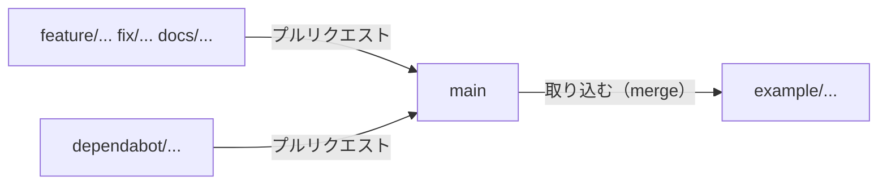

# Development（開発の進め方）

このリポジトリ自体を更新するときの決まりです。1人で開発する前提で書いています。

- [1. 基本の考え方](#1-基本の考え方)
- [2. ブランチ](#2-ブランチ)
- [3. 作業の流れ](#3-作業の流れ)
- [4. 場面ごとの進め方](#4-場面ごとの進め方)
- [5. コミットの書き方](#5-コミットの書き方)
- [6. 自動テスト](#6-自動テスト)
- [7. バージョンの方針](#7-バージョンの方針)

---

## 1. 基本の考え方

- **`main` は、いつでもひな形として複製できる状態に保ちます。** 動かない状態を入れません。
- **`main` には、直接コミットしません。** 作業用のブランチを作り、プルリクエストでマージします。プルリクエストを作ると自動テストが動くので、壊れた変更が入るのを防げます。
- **構成の違うものは、`example/` で始まるブランチとして残します。** `main` にはマージしません。

---

## 2. ブランチ

| ブランチ | 寿命 | 使いみち |
| --- | --- | --- |
| `main` | 残し続ける | 最小の形のひな形 |
| `example/<内容>` | 残し続ける | `main` に何かを足した見本。または、別の構成を試した結果 |
| `feature/<内容>` | マージまで | 機能の追加や変更、依存の更新 |
| `fix/<内容>` | マージまで | 不具合の修正 |
| `docs/<内容>` | マージまで | 文書だけの変更 |
| `dependabot/...` | マージまで | Dependabot が自動で作ります。手では作りません |

`<内容>` は、英小文字とハイフンで短く書きます（例：`feature/add-memory-sample`、`example/add`）。

「マージまで」のブランチは、マージすると GitHub 側で自動で消える設定にしています。

ブランチ同士の関係は、次のとおりです。



変更は、必ず `main` に先に入れて、そこから `example/` に流します。逆向き（`example/` から `main`）には流しません。

---

## 3. 作業の流れ

どの変更も、次の流れで進めます。

### 3-1. ブランチを作る

```zsh
$ git switch main
$ git pull
$ git switch -c feature/<内容>
```

### 3-2. 変更して、確かめる

検査とテストを実行します。

```zsh
$ make js/fix
$ make js/check
$ make js/test
```

### 3-3. コミットして、プルリクエストを作る

```zsh
$ git add -A
$ git commit -m "add: 足し算のモジュールを追加。"
$ git push -u origin feature/<内容>
$ gh pr create --fill
```

### 3-4. 自動テストを待って、マージする

プルリクエストのページで、自動テストが緑になるのを待ちます（1〜2分）。緑になったら、マージします。

```zsh
$ gh pr merge --merge
```

赤の場合は、同じブランチで直して、もう一度 push します。緑になるまで、マージしません。

### 3-5. 手元を片付ける

```zsh
$ git switch main
$ git pull
$ git branch -d feature/<内容>
```

### 3-6. 見本のブランチに取り込む

`main` に入れた変更を、`example/` のブランチにも取り込みます。

```zsh
$ git switch example/add
$ git pull
$ git merge main
$ make js/install
$ make js/check
$ make js/test
$ git push
$ git switch main
```

`example/` のブランチが複数ある場合は、それぞれで行います。push すると、そのブランチでも自動テストが動きます。

---

## 4. 場面ごとの進め方

### 4-1. Dependabot からプルリクエストが届いた

毎週月曜の朝に、依存の更新がプルリクエストで届きます。対象は、次の3つです。

| 対象 | 記録されている場所 |
| --- | --- |
| JavaScript のパッケージ | `package.json`、`pnpm-lock.yaml` |
| Node.js のイメージ | `Dockerfile` |
| GitHub Actions のアクション | `.github/workflows/` |

1. 自動テストが緑なら、そのままマージします。
2. 赤の場合は、新しい版で書き方が変わっていることが多いです。プルリクエストを閉じて、`feature/` のブランチで、更新と修正をまとめて行います（「4-2」を参照）。
3. マージしたら、「3-6」の手順で、`example/` のブランチに取り込みます。

### 4-2. 手で依存を更新する

```zsh
$ git switch -c feature/update-dependencies
$ make js/outdated                      # 新しいバージョンがあるパッケージを確認する
$ make js/add TARGET=eslint@latest      # 最新版にする
$ make js/check
$ make js/test
```

そのあとは、「3-3」からの流れで進めます。

### 4-3. 見本のブランチを足す

別の書き方（別の言語から WebAssembly を作る、など）を試した結果や、機能の見本を残すときの手順です。

1. `main` からブランチを作ります。

   ```zsh
   $ git switch main
   $ git pull
   $ git switch -c example/<内容>
   ```

2. 内容を足します。そのブランチの説明を、`readme/EXAMPLE_<内容>.md` に書きます。
3. 検査とテストが通ることを確かめて、push します。プルリクエストは作りません。

   ```zsh
   $ git push -u origin example/<内容>
   ```

4. `main` の `README.md` の「Branch」の表に、1行足します。これは、ふつうの流れ（`docs/` のブランチとプルリクエスト）で行います。

### 4-4. 見本のブランチだけを直す

見本にだけある内容（`add` のモジュールなど）を直すときは、`example/` のブランチに、直接コミットして push します。`main` には関係しないので、プルリクエストは作りません。push すると、自動テストが動きます。

### 4-5. 取り込みで衝突した

`git merge main` で衝突が起きにくいように、次の決まりにしています。

- `README.md` と、`readme/` の番号つきの文書は、どのブランチでも同じ内容にします。ブランチごとの説明は、`readme/EXAMPLE_<内容>.md` に書きます。
- 見本のブランチでは、`main` にあるファイルの書き換えを、必要な分だけにとどめます（機能を呼び出す `src/main.js` など）。

それでも衝突した場合は、`main` の変更と、見本の内容の両方が残るように、手で直します。直したら、検査とテストを実行してから、コミットします。

---

## 5. コミットの書き方

- 1つのコミットには、1つの変更だけを入れます。
- メッセージは、種類を先頭に付けて、日本語で1行に書きます。

| 種類 | 使う場面 | 例 |
| --- | --- | --- |
| `add:` | 機能やファイルの追加 | `add: 足し算のモジュールを追加。` |
| `update:` | 既存の機能の変更、依存の更新 | `update: Node.js を 26 に更新。` |
| `fix:` | 不具合の修正 | `fix: 日本語のコメントがあると変換に失敗する問題を修正。` |
| `docs:` | 文書だけの変更 | `docs: 環境構築の手順を追記。` |

---

## 6. 自動テスト

[.github/workflows/test.yml](../.github/workflows/test.yml) で、次の順に実行します。

| 順番 | 内容 | 実行するコマンド |
| --- | --- | --- |
| 1 | 環境を作る | `make setup` |
| 2 | コードを検査する | `make js/check` |
| 3 | テストを実行する | `make js/test` |
| 4 | プログラムを実行する | `make run` |

動くのは、次のときです。

- プルリクエストを作ったとき、プルリクエストのブランチに push したとき
- `main` か、`example/` で始まるブランチに push したとき

失敗したときは、GitHub の「Actions」のページで、失敗した手順の記録を見ます。

---

## 7. バージョンの方針

| 対象 | 方針 | 上げるときに直す場所 |
| --- | --- | --- |
| Node.js | 長期サポート版（LTS）を使います。偶数のバージョンが、長期サポート版になります。Dependabot は、メジャーバージョンの更新を知らせない設定にしています | `Dockerfile` のイメージ、`.node-version`、`package.json` の `engines` の3か所 |
| pnpm | 版を固定しています | `Dockerfile` の `pnpm@...` と、`package.json` の `packageManager` の2か所 |
| JavaScript のパッケージ | 版を固定しています。更新は、Dependabot に任せます | `package.json` |

バージョンを上げたら、[README](../README.md) の「Tool Versions」の表も直します。
